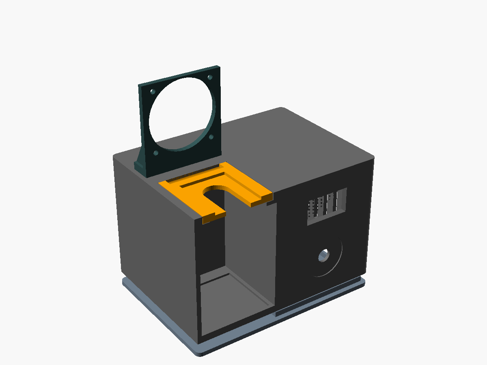

# ColdPull Station — стенд для чистки хотендів (cold pull)

> В цьому репозиторії також є Android-додаток для Svakom Alex Neo 2:
> [`android/NeoRemote`](android/NeoRemote/README.md).

Настільний стенд, який гріє знятий хотенд (наприклад, Bambu Lab A1 / P1 / X1 та інші з
24 V нагрівачем) і проводить вас через чистку сопла методом **cold pull**. Чистка йде
на столі, принтер розбирати не треба.



**Що вміє:**

- нагрів до 300 °C із PID-регулюванням і **автотюном** PID;
- OLED-дисплей 128×64 (температура, ціль, потужність) і керування однією ручкою-енкодером;
- **майстер cold pull** на 4 кроки, зі звуковими сигналами;
- вентилятор радіатора сам вмикається, коли температура вища за 50 °C;
- захист: обрив і замикання датчика, перегрів, «не гріє», падіння температури,
  нагрів без команди (пробитий MOSFET), автовимкнення через 15 хв без дій, watchdog;
- налаштування зберігаються в EEPROM.

## Як працює cold pull

| Крок | Що робить стенд | Що робите ви |
|---|---|---|
| 1. Нагрів | гріє до 265 °C (можна 260–270) | чекаєте сигналу |
| 2. Промивка | тримає температуру | проштовхуєте нейлон, поки не піде чистий пруток, потім клік |
| 3. Остигання | вимикає нагрів, дме вентилятором до 45 °C | пруток не чіпаєте |
| 4. Ривок | гріє до ~160 °C, довгий сигнал | різко тягнете пруток: бруд виходить «пробкою» у формі каналу |

Якщо кінчик брудний, клікніть ще раз, і цикл повториться. Для ривка з PLA поставте на
кроці 4 температуру 90–100 °C (ручкою), для PETG 130–140 °C.

## Що купити

| Деталь | К-сть | Примітка |
|---|---|---|
| Arduino Nano (ATmega328P, 5 V) | 1 | або Pro Mini 5V 16 MHz |
| OLED 0.96" 128×64 I2C (SSD1306) | 1 | 1.3" SH1106 теж підійде (див. `config.h`) |
| Енкодер KY-040 з кнопкою + ручка | 1 | |
| MOSFET-модуль **D4184 / AOD4184** (logic-level) | 2 | нагрівач і вентилятор. IRF520-модулі **не підходять**: вони не відкриваються від 5 V |
| DC-DC знижувач 24 V → 5 V (Mini-360 / LM2596) | 1 | живлення Arduino |
| Блок живлення 24 V, ≥ 3 A | 1 | нагрівач хотенда ~48 Вт |
| Гніздо DC 5.5×2.1 під гайку M8 | 1 | |
| Клавішний вимикач KCD1 (19×13) | 1 | |
| Запобіжник 3 A + тримач | 1 | на вході 24 V |
| Резистор 4.7 кОм | 1 | підтяжка термістора |
| Конденсатор 10 мкФ (або 100 нФ) | 1 | A0 → GND, фільтр шуму |
| Вентилятор 4010, 24 V | 1 | обдув радіатора хотенда |
| Пасивний п'єзо-бузер | 1 | можна не ставити |
| Кабель або роз'єм під ваш хотенд | 1 | див. «Підключення хотенда» |
| Гвинти M3×8 (4 шт.), M3×10 (6 шт.), M2×5 (4 шт.), гумові ніжки 10 мм | | |
| Силіконовий або PTFE-килимок 40×36 мм, латунна щітка | | у нішу під сопло |

## Схема підключення

```
 24V БЖ ──[запобіжник 3A]──[вимикач]──┬──► VIN+ MOSFET №1 (нагрівач)
                                      ├──► VIN+ MOSFET №2 (вентилятор)
                                      └──► IN+  DC-DC ── OUT+ 5V ──► Arduino 5V
                                                                (НЕ на VIN Nano!)
 GND БЖ ──► VIN− обох MOSFET, IN− DC-DC, GND Arduino (спільна земля)

 MOSFET №1 (D4184): TRIG/PWM ← D9,  GND ← GND Arduino,  OUT+ / OUT− → нагрівач хотенда
 MOSFET №2 (D4184): TRIG/PWM ← D5,  GND ← GND Arduino,  OUT+ → червоний, OUT− → чорний вентилятора

 Термістор хотенда:
     5V ──[4.7 кОм]──┬── A0
                     ├── термістор ── GND
                     └── 10 мкФ ───── GND

 OLED:     VCC→5V  GND→GND  SDA→A4  SCL→A5
 Енкодер:  CLK→D2  DT→D3  SW→D4  +→5V  GND→GND
 Бузер:    D6 → (+) бузера, (−) → GND
```

Усе можна змінити в [`firmware/ColdPullStation/config.h`](firmware/ColdPullStation/config.h).

### Підключення хотенда

Хотенд підключається до стенда **своїми** проводами нагрівача й термістора. Роз'єми
відрізняються між моделями (у A1 і P1/X1 вони різні), тому:

1. Купіть запасний кабель або відповідь роз'єму для вашого хотенда, або зробіть
   перехідник.
2. **Перевірте виводи мультиметром** на холодному хотенді:
   - нагрівач 24 V / 48 Вт має опір близько **12 Ом** (24² / 48);
   - термістор NTC 100K показує близько **100 кОм** при кімнатній температурі;
     ~1.1 кОм означає PT1000 (тоді `SENSOR_TYPE SENSOR_PT1000` і підтяжка 1–2.2 кОм).
3. Якщо термістор показує інший опір при 25 °C, виставте `NTC_R25` і `NTC_BETA`
   у `config.h`.

## Прошивка

**Arduino IDE:** встановіть бібліотеку **U8g2** (Менеджер бібліотек), відкрийте
`firmware/ColdPullStation/ColdPullStation.ino`, плата *Arduino Nano*, процесор
*ATmega328P* (для дешевих клонів *ATmega328P (Old Bootloader)*), завантажте.

**PlatformIO:**
```
cd firmware
pio run -t upload
```

**Готовий .hex** (налаштування за замовчуванням: SSD1306, NTC 100K, 4.7 кОм):
`firmware/build/ColdPullStation-nano.hex`
```
avrdude -p m328p -c arduino -P /dev/ttyUSB0 -b 115200 -U flash:w:ColdPullStation-nano.hex:i
```
(для Old Bootloader: `-b 57600`)

Прошивка займає ~27.7 КБ flash і ~1 КБ RAM.

## Перший запуск

1. Без хотенда стенд покаже «Обрив датчика». Так і має бути.
2. Підключіть **холодний** хотенд. Температура має показувати кімнатну (±3 °C).
   Якщо ні, перевірте тип датчика і `config.h`.
3. Зробіть **автотюн PID**: утримайте ручку 1 с → «Автотюн PID» → виберіть
   240 °C → клік. Займає 3–6 хвилин, коефіцієнти збережуться самі.
4. Перевірте, що вентилятор вмикається вище 50 °C.

## Керування

| Дія | Головний екран | Майстер cold pull |
|---|---|---|
| Обертання | ціль ±5 °C | температура поточного кроку |
| Клік | старт / стоп нагріву | наступний крок |
| Утримання 1 с | меню | вихід (нагрів вимикається) |

Меню: **Cold pull (майстер)** · **Автотюн PID** · **Скинути налашт.** · Назад.

## Корпус (3D-друк)

Файл: [`hardware/enclosure.scad`](hardware/enclosure.scad) (OpenSCAD, усі розміри
параметричні). Готові STL лежать у `hardware/stl/`.

| Деталь | Друк |
|---|---|
| `body.stl` | догори дном, без підтримок, 3 стінки, 20 % заповнення |
| `lid.stl` | як є |
| `adapter.stl` | як є, **ASA/PC** (поруч гарячий хотенд) |
| `fan.stl` | як є |

Матеріал корпусу: PETG, ABS або ASA. **PLA не підходить.**

**Адаптер хотенда треба підігнати під свою модель.** Хотенд заходить спереду: шийка
(між радіатором і нагрівачем) іде в U-проріз, радіатор лягає в поглиблення, а
нагрівач із соплом висить у ніші над килимком. Заміряйте штангенциркулем і задайте
в `enclosure.scad`:

- `neck_w`: ширина шийки + 0.5 мм;
- `hs_w`, `hs_d`: розмір основи радіатора + 0.4 мм;
- `pocket_h`: товщина адаптера, не більша за відстань між радіатором і нагрівачем.

Потім `part = "adapter"`, F6, експорт STL. Адаптер змінний, тож під кожну модель
хотенда можна надрукувати свій.

Також перевірте відстань між отворами вашого OLED-модуля (`oled_hole`), бо у різних
продавців вона трохи різна.

## Безпека

- Нагрівач гріється до 300 °C. Не залишайте стенд увімкненим без нагляду.
- Ставте запобіжник на вході 24 V.
- Перевірте, що земля спільна, а дроти нагрівача мають переріз не менше 0.5 мм².
- Захист у прошивці не замінює уважності. Перед першим довгим нагрівом
  перевірте, що температура вимірюється правильно.

## Перевірка прошивки без заліза

`firmware/test/run.sh` збирає прошивку для ПК із заглушками Arduino і проганяє її на
тепловій моделі хотенда: нагрів, автотюн, усі 4 кроки cold pull, помилку «не гріє»
і автовимкнення.

```
./firmware/test/run.sh
```

## Що перевірено, а що ні

- ✅ Прошивка компілюється avr-gcc для ATmega328P без попереджень.
- ✅ Логіка (PID, автотюн, майстер, захист) працює на тепловій моделі.
- ✅ Корпус рендериться в OpenSCAD, STL експортуються.
- ⚠️ На реальному залізі ще не запускалось. Розміри адаптера під конкретний хотенд
  і розпіновка роз'єму хотенда залежать від моделі, їх треба заміряти самостійно.
