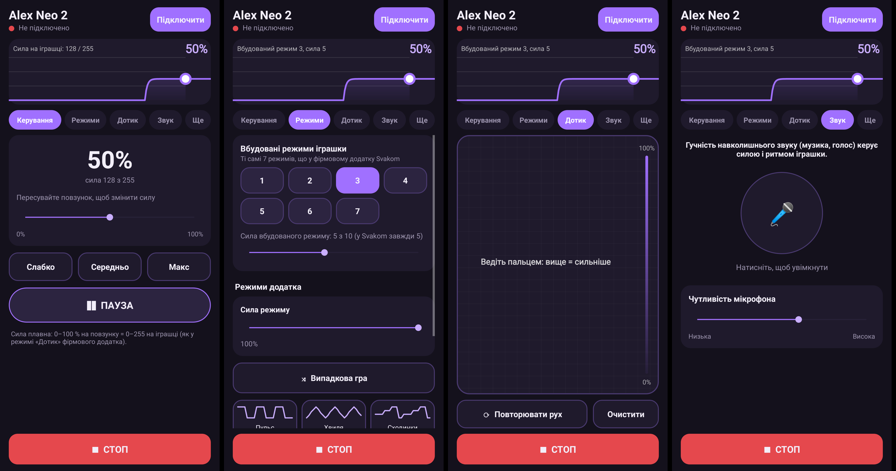

# Neo Remote — Android-додаток для Svakom Alex Neo 2

Власний додаток для керування Svakom Alex Neo 2 по Bluetooth: без акаунта, без
інтернету, без реклами. Додаток спілкується з іграшкою напряму через BLE.



## Встановлення

1. Скопіюйте на телефон [`release/NeoRemote.apk`](release/NeoRemote.apk).
2. Відкрийте файл. Android попросить дозволити встановлення з цього джерела: дозвольте.
3. Перед першим підключенням **закрийте фірмовий додаток Svakom/FeelConnect**.
   Іграшка приймає лише одне BLE-підключення, і поки інший додаток тримає її,
   Neo Remote її не побачить.
4. Увімкніть іграшку, натисніть **Підключити**. Додаток сам знайде пристрій з
   іменем `Alex NEO 2` і підключиться. Наступного разу підключення буде
   автоматичним при запуску.

Потрібен Android 8.0 або новіший. На Android 11 і старших для пошуку
Bluetooth-пристроїв має бути увімкнена геолокація (таке обмеження Android).

## Що вміє

| Вкладка | Що робить |
|---|---|
| **Керування** | плавний повзунок 0–100 % (0–255 на іграшці), «Слабко / Середньо / Макс», СТАРТ / ПАУЗА |
| **Режими** | 7 вбудованих режимів іграшки (як у фірмовому додатку) з вибором сили, плюс 11 режимів додатка і «Випадкова гра» |
| **Дотик** | ведіть пальцем: вище = сильніше. Намальований рух можна повторювати по колу |
| **Звук** | музика або голос через мікрофон керують силою, повзунок чутливості |
| **Ще** | швидкі тестові команди, своя HEX-команда, журнал BLE |

Поруч зі статусом підключення показується заряд батареї іграшки.

Велика червона кнопка **СТОП** унизу зупиняє все одразу. При втраті зв'язку
режими теж зупиняються, щоб після перепідключення нічого не ввімкнулось раптово.

## Протокол

Узято з офіційного додатка **SVAKOM 4.1.6** (пакет `com.sva.base_ble_library`).
Іграшка визначається там як `productCode 248`.

| | |
|---|---|
| BLE-ім'я | `Alex NEO 2` або `S63E Alex NEO 2` |
| Сервіс | `0000ffe0-0000-1000-8000-00805f9b34fb` |
| Запис команд | `0000ffe1-…` |
| Сповіщення (відповіді) | `0000ffe2-…` |

| Команда | Байти | Примітка |
|---|---|---|
| Плавна сила | `55 04 00 00 00 VV AA` | `VV` = 0…255. Так працюють «Дотик», «Звук» і «Музика» у Svakom (пакет кожні 120 мс) |
| Вбудований режим | `55 03 00 00 MM SS` | `MM` = 1…7, `SS` = сила (Svakom завжди шле 5) |
| Стоп | `55 04 00 00 00 00 AA`, потім `55 03 00 00 00 00` | |
| Запит заряду | `55 00` | відповідь `55 80 xx xx xx BB`, де `BB` = % |

Додаток шле не частіше за 1 пакет / 100 мс, як і фірмовий.

У відкритій бібліотеці Buttplug для цієї іграшки є команда `55 03 03 00 LL LL+5`.
Насправді вона вмикає вбудовані режими 1–3, а не силу. Тому Neo Remote
використовує команди з фірмового додатка.

## Збірка з вихідного коду

Gradle і Android Studio не потрібні:

```
sudo apt install openjdk-17-jdk aapt dalvik-exchange zipalign apksigner
./build.sh
```

Скрипт сам завантажить Android API 34 (пакет `org.robolectric:android-all` з
Maven Central), збере, вирівняє й підпише APK у `release/NeoRemote.apk`.

Ключ підпису лежить у `keystore/neoremote-debug.jks` (пароль `neoremote`). Це
відкритий тестовий ключ, він потрібен лише для того, щоб нові версії
ставилися поверх старої. Не використовуйте його для інших проєктів.

| Файл | Що всередині |
|---|---|
| `src/.../NeoBle.java` | пошук, підключення, перепідключення, команди |
| `src/.../MainActivity.java` | інтерфейс і «рушій» (кожні 50 мс обчислює рівень) |
| `src/.../Patterns.java` | 11 режимів і випадковий режим |
| `src/.../TouchPadView.java` | режим «Дотик» |
| `src/.../SoundMeter.java` | режим «Звук» |

## Що перевірено, а що ні

- ✅ APK збирається, підписується (v2/v3) і проходить `apksigner verify`.
- ✅ Команди звірено з декомпільованим кодом додатка SVAKOM 4.1.6.
- ✅ Симуляція BLE (Robolectric `ShadowBluetoothGatt`): після підключення
  надсилаються правильні байти для сили, режимів, стопу й батареї, заряд
  читається з відповіді.
- ✅ Додаток запускається в Robolectric (Android 14 на JVM): усі вкладки
  відкриваються, режими працюють, падінь немає. Скриншоти вище звідти.
- ⚠️ На реальному телефоні з реальною іграшкою ще не запускався. Якщо щось не
  так, відкрийте вкладку **Ще → Журнал**: там видно, що знайдено, до чого
  підключилось і які байти надіслано.
